# Inception City

**A folding, dreaming city you can bend with your hands and walk through on foot.**

**[Play it in your browser](https://msavastano.github.io/Inception-City/)** · [Read the city plan](docs/CITY_PLAN.md)

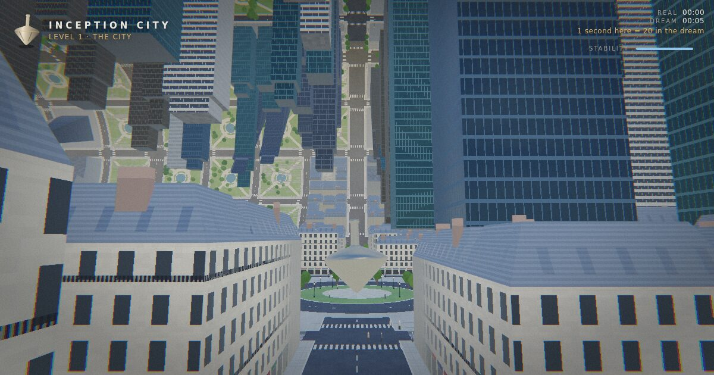

Inception City is an endless, procedurally generated Paris printed on a sheet of fabric. Every street is a hinge. Grab the city and fold it until whole districts hang upside down in the sky, then drop to street level and walk up the curl and onto the ceiling, because in a dream gravity follows the street. Ride a folding street up over the city, or step into the hotel corridor that turns like a barrel. Fold too hard and the dream's projections turn to stare at you. Go deeper and time stretches, snow falls, and in Limbo the city crumbles into the sea.

It runs in any modern browser with WebGL 2, on desktop and on phones. Every facade, cobble and cloud is generated from a seed, and so is the drone under it all. (Two things are not made here: how people move, a few free animation clips packed into the code, and under a megabyte of free recordings for the rain, the birds, the sea and the footsteps. See [ASSETS.md](ASSETS.md).)

| Walking towards a fold | Walking up the curl |
| --- | --- |
| 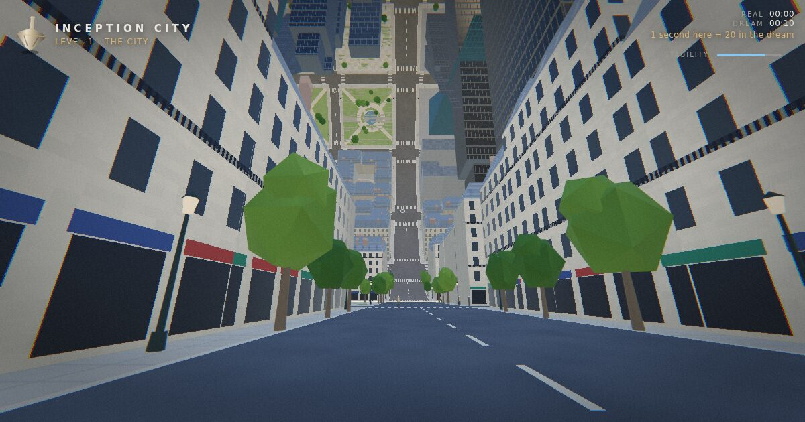 | 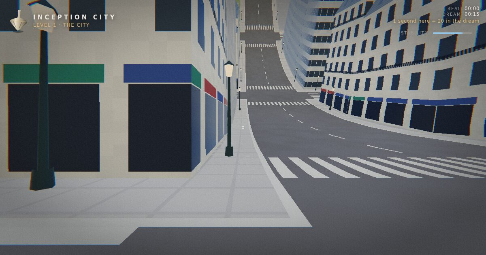 |
| **City in a Box** | **The Scroll** |
| 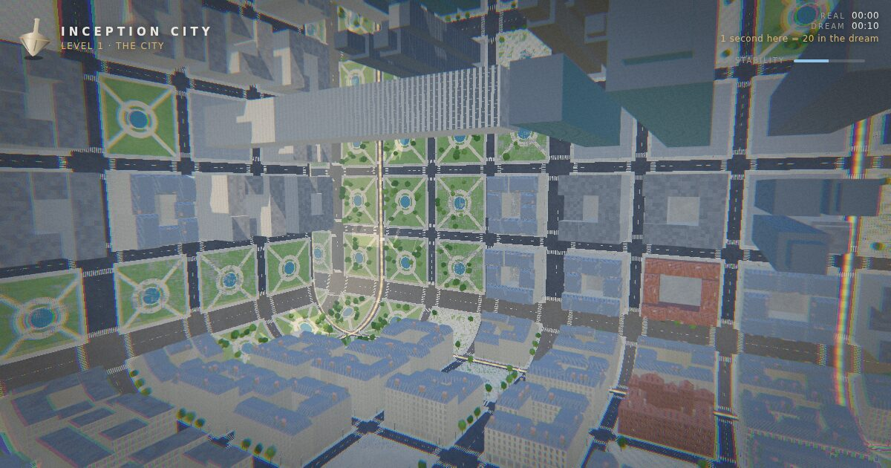 | 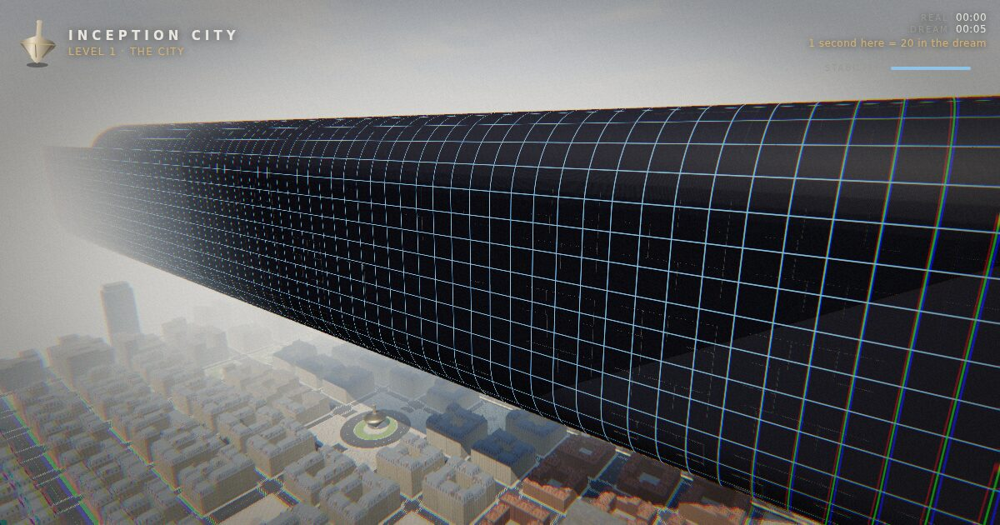 |
| **The rotating hallway** | **Inside, standing on the wall** |
| 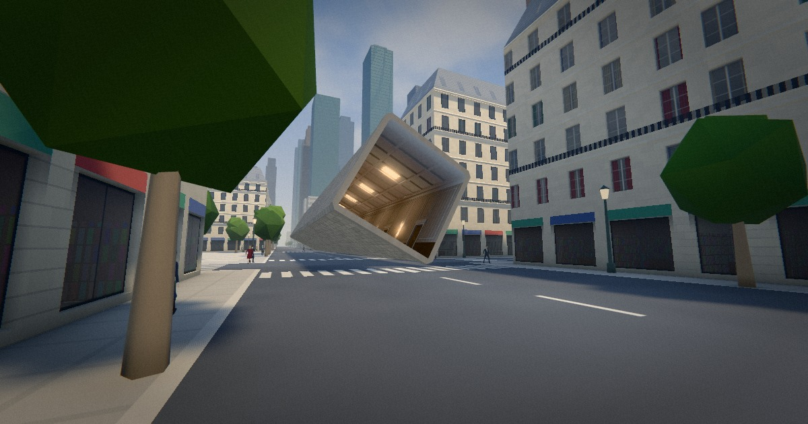 | 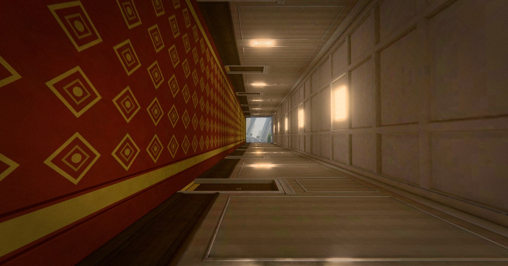 |
| **Riding the fold** | **At the top** |
| 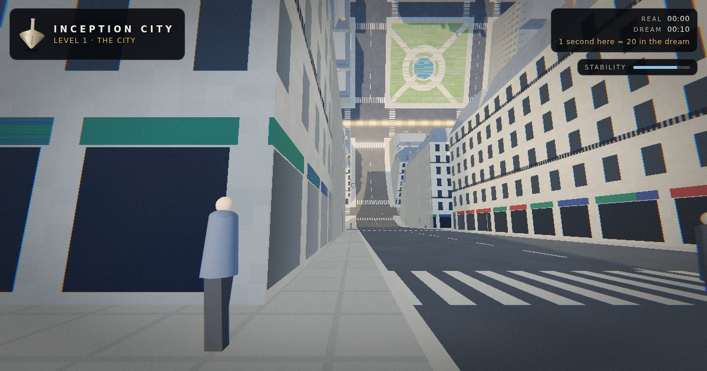 | 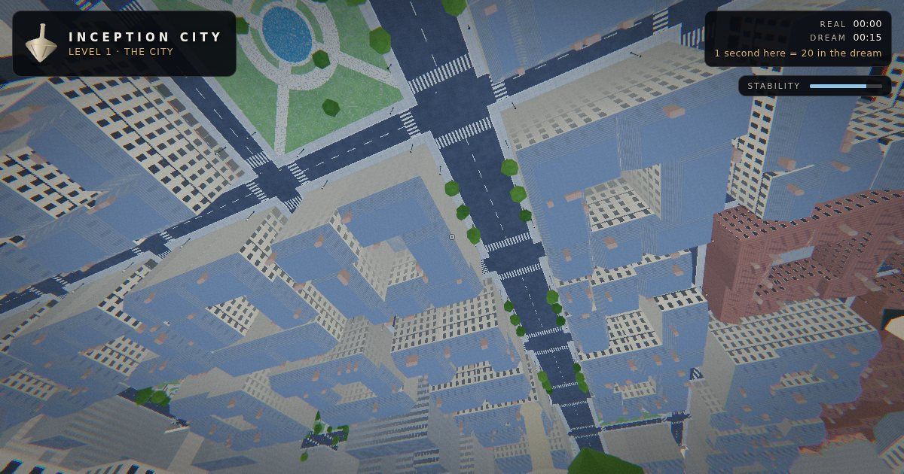 |
| **Rooms behind the windows** | **Wet streets in the Rain** |
| 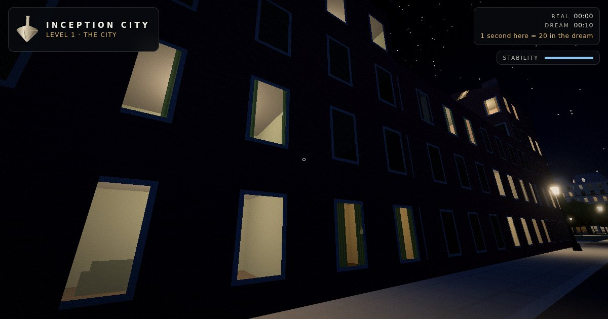 | 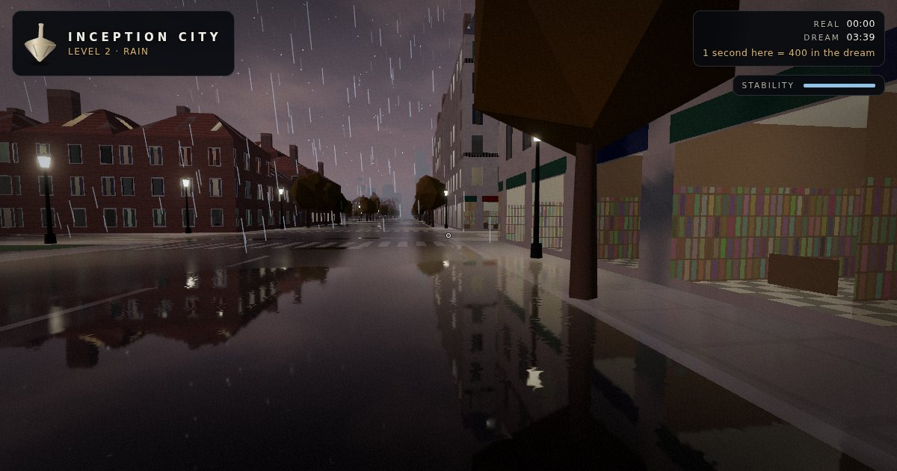 |
| **Behind the dreamer (C)** | **Heading for the curl** |
| 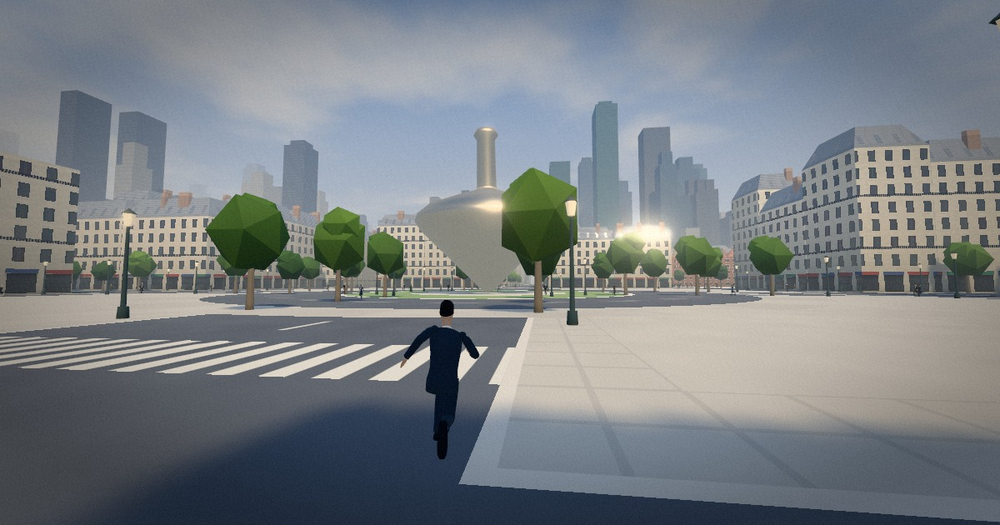 | 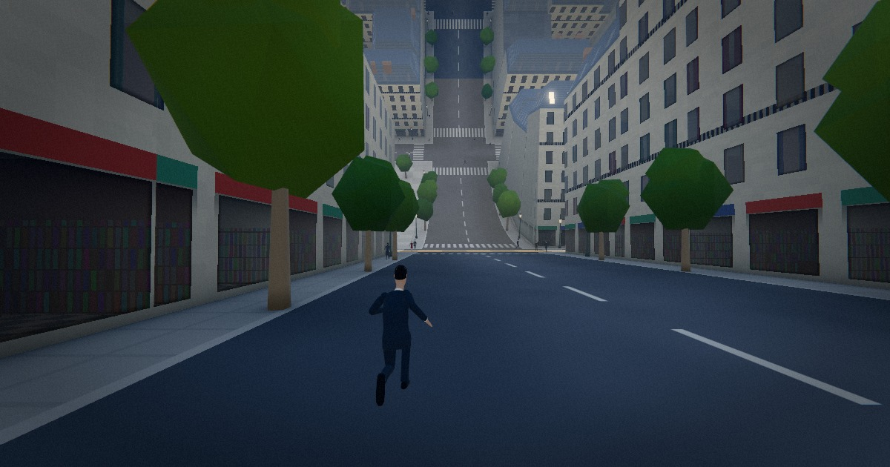 |
| **The café explosion** | **Hanging in slow motion** |
| 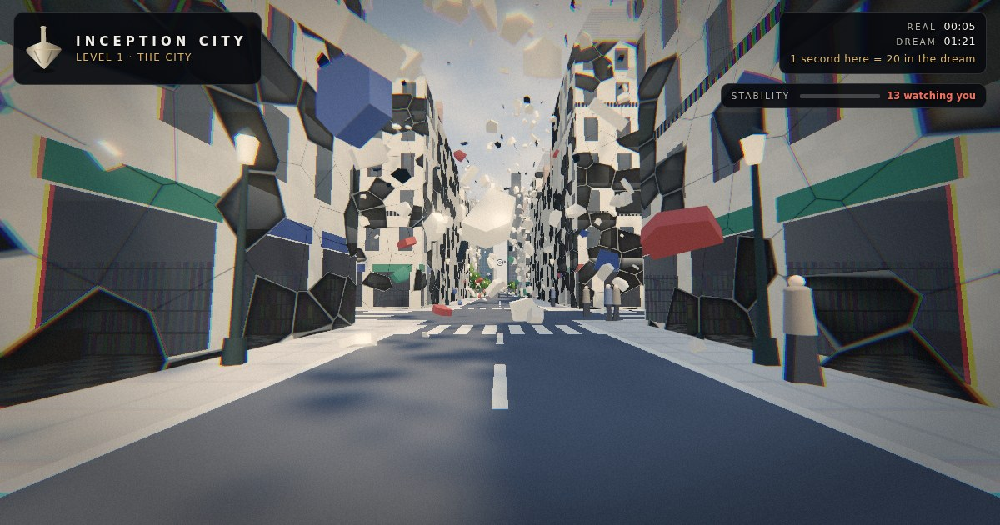 | 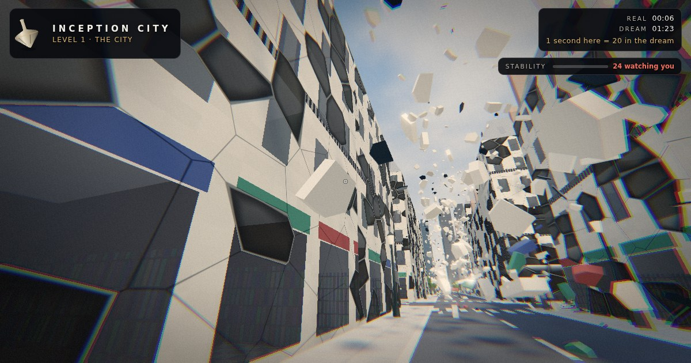 |

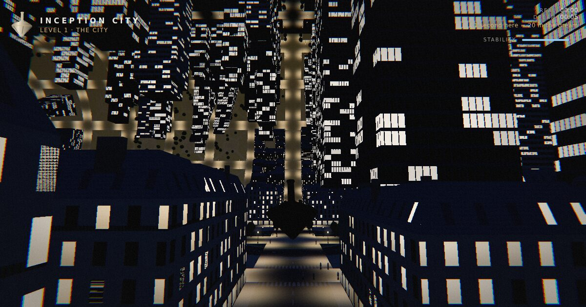

## What you can do

**Architect mode** looks down on the city like a model on a table.

- **Fold:** press on a street and drag. The hinge forms under the cursor, and the further you drag, the further the city bends, up to a full 180°. Creases snap to streets. Hold Shift to fold downwards.
- **Raise:** paint over blocks to grow or shrink the buildings.
- **Dreamscapes:** six one-click compositions: *The Paris Fold*, *Double Fold*, *The Scroll*, *Escher Steps*, *City in a Box* and *The Hallway*.
- **Sculpt after the fact:** every fold has its own angle slider, and Undo removes the newest.
- **Share:** the whole dream (seed, level, time of day and folds) fits in the link.

**Dream Walk** puts you on the sidewalk in first person, or behind your own shoulder.

- Walk and run through the streets, and fold the street ahead of you to watch the road rise into a wall, then climb it.
- **Ride the fold (E):** the street you are standing on folds up and over the city and carries you with it, until you hang upside down 96 m above the districts behind you.
- **The rotating hallway (H):** a hotel corridor rises around you and turns like a barrel. Its walls carry you up until you slide onto the next one, so you end up running along the walls and the ceiling. Walk out of either end to get back to the street.
- **Behind the dreamer (C):** swap the first-person eye for a camera over your own shoulder and watch yourself walk, run and jump, up the curl and along the hallway's walls. The camera keeps out of buildings and stays on your side of the folded street.
- Trees, lamps, buildings and the monument are solid. The projections walk the sidewalks with you: men and women in suits, long coats, dresses and hats, some with a briefcase, each at their own pace. Now and then one stops at a corner. When the dream grows unsteady they turn their heads to watch you pass, then stop and stare, then run at you.
- Press K for the kick: every fold collapses at once with a ripple and a BRAAAM, and you wake up a level.
- **The café explosion:** fold too hard and stability hits zero. The facades around you crack and blow out into the street, then the dream slows almost to a stop and the stone, glass and shop awnings hang in the air while you walk among them, until the kick arrives on its own. It happens in architect mode too, around the spot you are looking at.

**Take the job** (Heist mode) turns the dream into a game. Go down three already-folded cities through sleep machines, plant an idea in a guarded target on Level 3, then ride the kicks back up and wake before the topside clock runs out. Start it from the title screen or the desk.

- The topside clock starts at 8:00 and runs at full speed on Level 1, half on Level 2 and a quarter on Level 3, so time spent deep is cheap.
- Follow the beams of light: blue for a sleep machine, gold for a kick, white for your totem, red for the target. Kicks also play a music box you can hear from a few blocks away, and only work on the level where you found them.
- Projections hurt you instead of throwing you out. You heal in your own time, so healing deep costs less topside time.
- Die in a dream and you wash up in Limbo, where topside stops but your lucidity runs out unless you find its kick.
- Each job is a seed: "Share this job" sends someone the same three cities.

**Dream levels** change everything at once: palette, weather, colour grade, ambient drone and time dilation.

| Level | | Time |
| --- | --- | --- |
| 1 · The City | Clear Paris morning | ×20 |
| 2 · Rain | Dusk, wet streets that mirror the city, restless projections | ×400 |
| 3 · Snow | White silence | ×8,000 |
| Limbo | Ash, a grey sea, the city sinking into it | ∞ |

## Controls

| | Architect | Dream Walk |
| --- | --- | --- |
| Move | Right-drag to orbit, middle-drag to pan, scroll to zoom (the Orbit tool puts orbit on the left button) | WASD or arrows, Shift to run, Space to jump |
| Look | Same as move | Mouse (click to capture it), or drag |
| Fold | Drag across a street with the Fold tool (F) | F folds the street ahead up, V drops it away, E rides the street you stand on |
| Other | R raise brush, O orbit, Z undo, H the Hallway dreamscape, double-click to fly to a spot | H raises or lets go of the rotating hallway, C switches between first person and the camera behind you, Esc to pause, Q to wake up |
| Anywhere | Tab switches mode, K is the kick, 1 to 4 pick the level, M mutes | |
| Heist mode | | As Dream Walk; K uses this level's kick once you have found it, Esc pauses or abandons the job |

On touch screens: in architect mode one finger folds or paints (or orbits with the Orbit tool) and two fingers zoom and pan. In Dream Walk a left-thumb stick walks, dragging anywhere else looks, and buttons jump, fold, ride, raise the hallway, kick, switch the view and wake.

### Link parameters

`#s=` seed, `#l=` level (1 to 4), `#t=` time of day (0 is noon, 1 is midnight), `#f=` folds, and `#q=` quality (`low`, `medium`, `high` or `ultra`). The Share button writes all of them for you. `#job=` is a Heist mode job (its seed), written by "Share this job".

The look has its own dials, for trying things out: `#tone=` picks the tone curve (`neutral`, `agx` or `aces`), and `#ao=`, `#haze=`, `#glow=`, `#relief=`, `#exposure=`, `#contrast=` and `#saturation=` scale the contact shadows, the haze, the lamps' glow at night, the depth of the walls (window reveals, joints, the shadows under ledges) and the grade (1 is the default, 0 is off). For example `#tone=agx&haze=1.5` is a softer, hazier, more film-like city. The defaults live in [`src/world/look.ts`](src/world/look.ts) and, per dream level, in [`src/world/themes.ts`](src/world/themes.ts).

## How it works

The short version: **everything is simulated on the flat sheet, and folding happens only in the vertex shader.**

- **Fabric space and world space.** Generation, collision, the crowd, the dreamer's footsteps and streaming all live on the unfolded sheet. A fold is a rigid transform that depends only on how far a point lies past the hinge, so it is continuous, it preserves distances along the street (which is why you can walk up a curl with no special code), and nested folds compose like paper. Crossing folds cut the sheet like the corners of a paper box. The maths is in [`src/core/fold.ts`](src/core/fold.ts), mirrored in GLSL in [`src/city/shaders.ts`](src/city/shaders.ts), and pinned by [`tests/fold.test.ts`](tests/fold.test.ts).
- **About eleven draw calls for the whole city.** Each kind of object is one instanced mesh, and each streamed 256 m chunk owns a fixed slab of instances, so loading a chunk is one partial buffer upload and the draw-call count never grows. (At night the lamp halos add one, and one more in the Rain, where the wet street mirrors them.)
- **Streaming after folding.** Chunks are chosen by their distance *after* folding, so the districts hanging overhead are loaded even though they are far away on the sheet.
- **No textures.** Facades, roofs, streets, parks, snow, puddles, crease lines and the glowing underside of a fold are all painted procedurally in shaders.
- **Rooms behind the windows.** Each window is a hole into a room traced in the facade shader (interior mapping): walls, floor, a ceiling lamp, curtains and furniture shift with parallax as you walk past, with no extra geometry. Far away a window fades back to a flat pane.
- **Walls with depth.** The buildings are still boxes, but close to, the glass sits back in its wall. The facade shader follows the line of sight in from the wall's face: it meets the stone side of the opening or, further along, the glass, with its frame and glazing bars. The side that faces the sun is lit, the lintel is dark, and the wall's edge throws its shadow across the glass and the curtains. Cornices, string courses, balcony slabs, awnings and sills shade the wall under them by their reach and the sun's height, and the joints in stone, brick and concrete are carved by leaning the normal. No geometry, textures or draw calls are added, and on Low quality the relief is compiled out of the shader, so it costs nothing there. See section 5.11 of the city plan.
- **Wet streets.** In the Rain the street is a mirror. The city is drawn a second time from below the street at reduced resolution, and the ground looks it up: sharp in puddles that ripple with raindrops, smeared into long streaks on wet asphalt. On Low quality the street lamps' reflections are traced analytically instead. See [`src/fx/reflection.ts`](src/fx/reflection.ts).
- **Light and air.** Contact shadows are computed, not sampled: the painters know where the walls, trees and lamp posts stand, so they darken the sky's light beside them for a few multiplies per pixel on every quality tier. Distance shows as haze that takes the colour of the sky in the direction you look, so the city hanging overhead goes blue, and at the edge of the streamed city things dissolve into the real sky instead of a fog colour. At night the lamps light the facades and wear halos. The tone curve is Khronos PBR Neutral, with a small grade per level. See [`src/world/atmosphere.ts`](src/world/atmosphere.ts) and section 5.8 of the city plan.
- **GPU picking.** Clicking on a folded city renders a single pixel of fabric coordinates under the cursor, so a fold can start on a wall or a ceiling.
- **The café explosion.** At zero stability a blast wave runs through the building shader, cracking each wall into cells and opening some of them onto the rooms behind, while a few thousand instanced shards leave the same walls at the same moments. The dream's clock then runs at about a sixth of real time, but the dreamer keeps real time. See [`src/world/collapse.ts`](src/world/collapse.ts).
- **One exception to the rule.** Inside the rotating hallway, gravity points at the real ground. The dreamer is simulated in the corridor's own spinning frame, with friction that holds until the floor tilts past about 31°, and the camera's up eases toward whichever wall is underfoot. See [`src/world/hallway.ts`](src/world/hallway.ts).
- **People.** The dreamer and the crowd share one skeleton and a handful of walking, running and standing clips (free CC0 motion data, [ASSETS.md](ASSETS.md)). Their bodies and clothes are built in code on that skeleton. The dreamer is one skinned mesh; the whole crowd is another, drawn in one call: each pedestrian is an instance that picks its clothes from the pieces in the mesh, its colours and build from a few numbers, and its pose from a texture that holds every clip's bones frame by frame. Every clip moves on by the ground its walker covers, so feet stay where they land. See [`src/people/`](src/people) and section 5.9 of the city plan.
- **Sound.** Under the generated drone each level has its own air, mixed from where you stand: a far rumble of traffic and birds near the parks in the City, rain that moves onto the awnings when you step under them, wind in the Snow, the sea in Limbo, a hum in the hallway. Footsteps follow what is underfoot (flagstones, tarmac, gravel, grass, snow, puddles, the pond, the hallway's carpet and its panelling), read on the CPU from the same layout rules the ground shader paints from. The crowd murmurs from where it actually stands and hushes when it turns to stare and rises when it gives chase; its nearest footsteps, the heist's music box and the sleep machine's hum are placed around your head, so they can be found by ear. The recordings are CC0 ([ASSETS.md](ASSETS.md)), about 830 kB of Opus, loaded only when first needed. See [`src/fx/audio.ts`](src/fx/audio.ts), [`src/fx/soundscape.ts`](src/fx/soundscape.ts) and section 5.10 of the city plan.
- **Adaptive quality.** Four tiers trade resolution, shadows, bloom, the wet-street mirror, view distance and crowd size, chosen from the device and adjusted to hold the frame rate.

The [city plan](docs/CITY_PLAN.md) covers the districts, the rules of the dream, the full fold algebra, the scaling strategy and the roadmap (multiplayer through a shared fold log, WebGPU and WebXR).

## Run it locally

```bash
npm install
npm run dev          # http://localhost:5173
npm test             # fold algebra, generator, hallway, mirror, café explosion, lighting-layout, people and sound tests
npm run build        # static site in dist/
npm run build:single # one self-contained HTML file in dist-single/
npm run bench        # screenshots of eight fixed views per quality tier, in bench/ (needs Playwright)
npm run listen       # a recording of the game's sound, scene by scene, in listen/ (needs Playwright)
```

`npm run bench` is for judging changes to the look: run it on a build before and after, then `node scripts/bench.mjs --compare before after --out compare` puts the two sets side by side. It also prints draw calls, triangles and render-target memory for each view. On a machine with a graphics card, `--gpu --time` (with `--channel msedge` or `chrome` to use an installed browser) also times each view's frame; add `--repeat 3` to load each view three times and take the middle time, because frame times move between page loads. Playwright is not a dependency of the game; install it with `npm i -D playwright && npx playwright install chromium` when you want the bench.

`npm run listen` is the same idea for the ears: after `npm run build` it plays a headless copy of the game through nine scenes (a street by day and by night, the Circus, a crowd, the Rain, the Snow, Limbo, the hallway, the Architect's height), records what comes out of the speakers into `listen/reel.webm`, cuts each scene out as an `.mp3` if `ffmpeg` is installed, and prints each scene's level and which beds were playing. `--scenes rain,hall` picks scenes and `--no-drone` leaves the drone out, to hear the recordings alone.

While `npm run dev` is running, `/lab.html` shows the people on their own, out of the city: `#clip=jog` plays a clip on the dreamer, `#sheet` turns him round, `#cast` lines the crowd up as the city draws it. It is a workbench for [`src/people/`](src/people) and is not part of the build.

Built with TypeScript, [Three.js](https://threejs.org) and [Vite](https://vite.dev). Every push to `main` is tested, built and published to GitHub Pages by [`.github/workflows/deploy.yml`](.github/workflows/deploy.yml).

## Project layout

```
src/
  core/    fold algebra, grid constants, seeded noise
  city/    chunk generator, shaders, materials, slab allocator, streamer
  world/   sky, haze and weather, dream levels and the look's dials, the projections crowd, the rotating hallway, the café explosion
  people/  the shared skeleton and its clips, bodies and clothes built in code, the dreamer's figure, the instanced crowd
  modes/   architect, dream walk, riding the fold, dreamscape presets
  game/    Heist mode: the job's rules, and its sleep machines, kicks, totem and target
  fx/      GPU picking, audio (the generated drone, the soundscape mixer, the packed recordings), post-processing, the wet-street mirror, lamp halos
  ui/      styles and the HUD totem
tests/     fold, generator, hallway, ride, mirror, café explosion, Heist mode, lighting-layout, people and sound tests
scripts/   the single-file build, the screenshot bench, the listening bench, and the animation and sound packers
docs/      the city plan and screenshots
```

## License

MIT
