# Inception City: the plan

> "You create the world of the dream. You bring the subject into that dream, and they fill it with their subconscious."

This document is the world bible and the engineering plan in one place. The first half describes the city as a place: its districts, the rules of the dream and the two ways to be in it. The second half explains how it is built so that it can keep growing without slowing down.

---

## 1. The idea in one paragraph

Inception City is a Paris-like city printed on a sheet of fabric. Every street is a potential hinge. An architect can grab the city and fold it, rolling whole districts up into the sky until they hang upside down overhead, and a dreamer can walk through the result on foot, up the curl and onto the ceiling, because gravity in a dream follows the street, not the planet. Push the dream too far and its projections notice you. Go deeper and time stretches, the weather turns, and eventually the city crumbles into the sea of Limbo.

---

## 2. The city

### 2.1 Layout

The city is an endless Manhattan-style grid laid out in fabric space (the flat sheet before any folding).

| Element | Size | Notes |
| --- | --- | --- |
| Block | 64 m | Street centrelines every 64 m in both directions |
| Street | 14 m kerb to kerb | 3 m sidewalks either side |
| Boulevard | 24 m | Every fourth line, tree-lined on both sides |
| Chunk | 256 m (4 × 4 blocks) | The unit of generation, streaming and memory |

Because hinges snap to street lines, a fold always lands in the open, never through a building. That one constraint is what makes folds read as architecture rather than as damage.

### 2.2 Districts

Districts are not hand-placed. Two low-frequency noise fields ("downtown" and "old town") paint the grid, so every seed produces a different but coherent city.

- **The Circus.** The four blocks around the origin form a round plaza with the city's monument at its centre: a 30 m spinning top, balanced on its point. It is the dream's anchor. Every fold is ordered relative to it, and the HUD totem mirrors it: steady when the dream is stable, wobbling when it is not.
- **Haussmann core.** Six-storey limestone perimeter blocks with shopfronts and coloured awnings, continuous wrought-iron balconies on the second and fifth floors, zinc mansard roofs with dormers, and forests of chimney pots. This is the Paris of the film.
- **Old town brick.** Narrower lots, red pitched roofs, white window trim, one chimney each. Patches of it break up the stone.
- **Downtown.** Glass curtain walls and modernist concrete towers with setback crowns, away from the centre. When the city folds, these are the stalactites hanging from the sky.
- **Parks and plazas.** Green blocks follow their own noise field, so they cluster into something like a Tuileries rather than scattering as single squares.
- **The Limbo shore.** On the deepest level the edges of the city sink. Beyond about 260 m from the Circus, towers lean and slide into a grey sea, and past 820 m there is only water and ruins.

### 2.3 Street furniture

Boulevards carry plane trees. Every street has lamps on both sides at a fixed rhythm (every 32 m), which at night lay pools of warm light on the pavement. Zebra crossings mark every intersection, and they double as the projections' crossing points.

---

## 3. The rules of the dream

1. **Streets are hinges.** Any street can become a fold line. A fold has a hinge, a direction, an angle and a radius. Up to eight folds can be alive at once.
2. **Gravity follows the fabric.** Anything standing on the city (a dreamer, a projection, a tree) is attached to the sheet. Walk towards a fold and the road simply rises ahead of you into a wall and then a ceiling, and you keep walking. The one exception is the rotating hallway (4.3): inside it, gravity points down at the real ground, and the corridor turns around you.
3. **Paper physics.** Parallel folds nest: a fold further from the Circus is carried along by a nearer one, like rolling up a carpet. Crossing folds cut the sheet the way you cut the corners out of paper before folding it into a box, so nothing has to stretch.
4. **The dream pushes back.** Every fold costs stability. Fast, violent folding costs more. The totem wobbles, the picture shakes and splits into colour fringes, and the projections start to stare.
5. **Projections defend the dreamer's mind.** Calm projections walk the sidewalks. As stability falls they stop and turn to look at you. When it collapses they hunt. If they reach you, you are kicked out.
6. **The kick.** A kick (the K key, or being caught) collapses every fold at once with a ripple through the ground and a BRAAAM. In first person, a kick also wakes you up one level. Afterwards the dream is calm: stability is back to full while the city unwinds, and the projections forget you.
7. **The café explosion.** If stability reaches zero, the dream comes apart around the dreamer. A blast runs out through the walls, cracking them and blowing pieces of stone, glass and shop awning out into the street, and then the dream slows almost to a stop: the debris hangs in the air while the dreamer can still walk among it. About four seconds later the kick arrives on its own (5.7).
8. **Time dilates with depth.** Each level runs faster than the one above. The HUD shows real time next to dream time.

### 3.1 Dream levels

| Level | Name | Dream seconds per real second | Mood |
| --- | --- | --- | --- |
| 1 | The City | 20 | Clear Paris morning, warm stone, a little haze |
| 2 | Rain | 400 | Dusk, wet streets and puddles that mirror the city, cold grade, autumn trees, restless crowd |
| 3 | Snow | 8,000 | White silence, snow on every roof and pavement, a lower drone |
| 4 | Limbo | ∞ | Washed-out colour, falling ash, a city crumbling into the sea |

Each level has its own palette for day and night, weather, air (haze and ground mist), exposure, colour grade and ambient drone pitch. The time-of-day slider runs from noon to midnight on every level, and at night roughly a third of the windows light up. Up close each lit window opens onto a room (5.5).

---

## 4. Two ways to be in the city

### 4.1 Architect (third person)

The architect looks down on the city like a model on a table.

- **Fold:** press on a street and drag. The hinge forms under your cursor, perpendicular to the direction you drag. The further you drag, the further it bends, up to 180°. With *Snap creases to streets* on, the hinge locks to the nearest street and the direction locks to the grid. Hold Shift to fold downwards into the ground.
- **Raise:** paint over blocks to grow or shrink buildings. Edits stick to the block even when it streams out and back in.
- **Orbit:** a plain camera, for looking without touching anything.
- **Dreamscapes:** six presets that each make a point about the fold algebra, or break it.
  - *The Paris Fold:* the film's shot. Half the city hangs overhead.
  - *Double Fold:* two opposite curls, two skies made of streets.
  - *The Scroll:* four nested quarter-folds roll the city up like a carpet.
  - *Escher Steps:* alternating up and down folds turn districts into a staircase.
  - *City in a Box:* four walls stand up, and the crossing-fold cut keeps the corners clean.
  - *The Hallway:* a hotel corridor turning like a barrel on the boulevard. Walk in at either end.
- **Fold list:** every fold is listed with its direction and a live angle slider, so you can sculpt after the fact. Undo removes the newest fold.
- **Share:** the whole dream (seed, level, time, folds and quality) fits in the URL hash, so a link reproduces exactly what you see.

### 4.2 Dream Walk (first or third person)

The dreamer is dropped onto a sidewalk at street level.

- WASD or arrows to walk, Shift to run, Space to jump. Mouse look with pointer lock, or drag to look where pointer lock is not available.
- **F** folds the street ahead of you upwards, so you can watch the road rise into a wall and then walk up it.
- **V** drops the street ahead away into a downward fold.
- **E** rides the fold: the street you are standing on folds up and over the city and carries you with it, until you hang upside down 96 m above the districts behind you. **E** again lowers you back down.
- **H** raises the rotating hallway around you on the nearest street. Press it again, or kick, to let it go.
- **C** switches between first person and the camera behind the dreamer (4.6).
- **K** is the kick. **Q** wakes you up into architect mode. **Esc** pauses.
- On touch screens, a left-thumb stick walks, dragging anywhere else looks, and on-screen buttons jump, fold, ride, raise the hallway, kick, switch the view and wake.
- Buildings, trees, lamps and the monument are solid. Footsteps follow your pace.

Switching between the two (Tab) is a camera flight, not a cut: the architect's view swoops down to the dreamer's eye, and back up again.

### 4.3 The rotating hallway

The hotel corridor from the film: 7 m square, 64 m long, red carpet, doors every 8 m. It rises out of the street, hangs with its axis just high enough that its corners clear the ground, and turns like a barrel. The spin is not steady. It follows a few incommensurate sine waves, so it surges and slackens like a van swerving on the level above.

It is the one place where gravity does not follow the fabric. The dreamer inside is simulated in the corridor's own frame with real gravity pointing at the ground:

- **Three frames.** Fabric (where the corridor sits on the sheet), the corridor frame carried through any folds at the corridor's centre (so a hallway on a folded street hangs at the fold's angle), and spin space, the corridor frame turned by the current angle, in which the walls never move.
- **Walls carry you.** A wall you stand on moves you with it exactly, so a slow turn walks you up the floor. Static friction holds until the floor tilts past about 31°, then you slide into the corner and onto the next wall, which becomes the floor.
- **The camera follows the wall.** The view's up eases toward the wall you are standing on, so the corridor stays steady and the world outside the open ends turns instead. In the air it swings back toward the real sky.
- **Ends are open.** Walk out of either end and you drop back onto the street, carrying your speed. Walk into an open end and the corridor takes you in.

The physics is pinned by `tests/hallway.test.ts`: standing still, a minute of tumbling that never leaves the walls and visits all four, the grip-then-slide angle, and walking out.

### 4.4 Riding the fold

**E** turns the fold algebra into a lift. The hinge goes on the first street at least π·48 + 12 m behind you, with the page facing forward and a 48 m radius. That distance matters: everything closer than π·R to the hinge is wrapped around the curl, everything beyond it is the rigid page. So you never ride the bend itself; you stand on a flat street that swings up and over like a turning page, and at 180° you are upside down at exactly 2R = 96 m, looking up at the city below. The fold uses a slower spring than F, the field of view widens while it moves, and gravity following the fabric means you can walk around up there.

### 4.5 Heist mode

A game played in Dream Walk ("Take the job" on the intro): go down three dreams, plant an idea in a target on Level 3, then ride the kicks back up and wake before the topside clock runs out.

- **One clock.** Topside, the waking world, starts at 8:00 and runs at ×1 on Level 1, ×½ on Level 2, ×¼ on Level 3 and not at all in Limbo. A minute of play costs 60, 30 or 15 topside seconds depending on where you spend it. (The film's ×20 per level would freeze the clock below Level 1, so the game uses a gentler ladder.)
- **Already folded.** Each level is its own city (the job's seed, hashed with the depth; Level 1 uses the seed itself) and arrives folded into a dreamscape: Level 1 the Paris Fold, Level 2 Escher Steps, Level 3 City in a Box, Limbo flat.
- **Things to find.** Each level's things are placed from the seed on sidewalk corners, inside zones laid out against its dreamscape, so the folds decide where they end up: Level 1's sleep machine is on the flap hanging overhead, Level 2's is up on the first terrace, Level 3's kick is up one of the box's walls. Every one has a beam of light drawn through the fold transform (a machine on the flap shines down out of the sky): blue for a **sleep machine** (a briefcase on a café table; walk into it to go one level deeper), gold for a **kick** (a gramophone; picked up and used with K, only on its own level, and heard from about four blocks away as a music box), white for your **totem** (Level 1 only; you need it to go under to Level 3, and the HUD totem and stability bar stay hidden until you have it) and red for the **target** (Level 3, with seven guards; stay within 3 m of them for 3 seconds). The objective line gives the distance and direction to the next thing you need, except kicks, which you find by ear.
- **Up the way you came.** Kicking up a level wakes you beside the machine you went under at, so a kick found on the way down saves a search on the way up.
- **Hurt and healing.** A projection that reaches you takes a quarter of your health (instead of throwing you out) and shoves you back, with two seconds of grace. Below half you limp, the picture edges run red and a heartbeat starts. You heal 1% per second of play while nothing is hunting you, so a full heal costs 100 topside seconds on Level 1 and 25 on Level 3: if you are hurt, heal deep. From Level 2 down the crowd is warier, and running past people raises their suspicion.
- **The café explosion** still goes off at zero stability. In a job it costs 40% health, and the kick that follows is free: a desperate way up a level without its kick.
- **Limbo.** If your health runs out you are sedated, so you wash up in Limbo instead of waking. Topside stops, but your lucidity runs down (90 s with your totem, 45 without). Find Limbo's kick to return to the level you fell from, at 35% health, or be lost.
- **Winning.** Take Level 1's kick (or crash Level 1) with the idea planted. The end card keeps the best topside time per job on your device, and "Share this job" links `#job=<seed>` so someone else can run the same three cities.

The rules live in `src/game/heist.ts` with no rendering in them, so `tests/heist.test.ts` plays whole jobs: placement, the clock ladder, healing cost by depth, hits and grace, Limbo, the free kick after a blast, the totem gate and the win.

### 4.6 Behind the dreamer

**C** (or the View button) swaps the first-person eye for a camera standing behind the dreamer, so you can watch yourself walk up the curl. First person stays the default, and the choice is remembered on the device. It works everywhere Dream Walk does: on the street, on a ride, inside the hallway and through a whole job.

- **The body.** A man in a dark suit, white shirt and dark red tie: one skinned mesh on the skeleton everyone in the dream shares (5.9), posed each frame from its clips (`src/world/dreamer.ts`). Standing, he breathes and shifts his weight. Moving, a stroll, a jog and a sprint are mixed by speed, and all three follow the same stride clock as the footsteps. That clock turns with the ground covered (one stride for each stride-length of street), so his feet stay where they land and you hear them as they do. In the air his legs tuck; landing from a standing jump, his knees take it. He turns to face the way you walk, while his neck and head turn towards where you look. In a job he reaches down when he picks something up and flinches when a projection strikes him.
- **The camera.** It looks exactly the way the dreamer does (tipped down 0.1 rad so the feet stay in the picture), from 3.8 m back, 0.35 m up and 0.6 m over the right shoulder.
- **The boom lives in fabric space.** Like the walker, the camera's boom is laid out on the flat sheet next to the walker and only then folded, at the camera's own spot. Walls are building footprints there, so the boom swings out to the shoulder, then back, and stops short of the first footprint (widened by 0.3 m for the near plane). Because a point a little above the sheet folds to a point a little above the folded street, the camera stays on the street's side of any curl, however the city is bent. Looking up, it slides along the street towards your feet instead of going under it. Where crossing folds cut the sheet, a spot a few metres away can fold to somewhere else entirely, so there the camera is carried rigidly with the dreamer's own frame instead.
- **Pull in fast, let out slow.** A wall behind you pulls the camera in at once; it eases back out over a second, so walking past corners doesn't make it pump. Pinned so close that it would be inside your head, the body is hidden and the view is simply first person.
- **In the hallway** the same boom is laid out in the corridor's own frame and kept inside its four walls, which turn with it.
- **Trees and lamp posts** don't stop the camera; pulling in at every one would make it lurch.

`tests/chase.test.ts` pins the boom against walls, against the footprints of a real generated city from 400 spots and headings, inside a turning hallway, and the body's stride clock, stride, head turn and placement.

---

## 5. How it is built

The stack is TypeScript, Three.js (WebGL 2) and Vite, with Vitest for the maths. There are no textures and no models to download. Every brick, window, awning, cobble and cloud is generated in code from the seed, and so is the drone under everything. The two exceptions are the people's animation clips (5.9) and under a megabyte of recorded sound (5.10), both CC0 and listed in `ASSETS.md`.

### 5.1 The key idea: fabric space and world space

Everything is simulated on the flat sheet (fabric space): generation, collision, the crowd, the dreamer's footsteps and the streaming decisions. Folding is a pure presentation transform, applied in the vertex shader on the GPU, with an exact CPU mirror for the few things that need world positions (the camera, picking, and deciding what is close enough to load).

This separation is what makes the whole thing tractable. The crowd does not know the city is folded. The dreamer's physics is the physics of walking on a flat street. Folding a district costs nothing on the CPU, because nothing on the CPU moves.

### 5.2 The fold algebra

A fold has a hinge point **h**, a unit normal **n** (pointing at the side that moves), an angle θ and a radius R. For a fabric point at distance d = (p − h)·n past the hinge, the fold is a rigid transform:

```
M(d) = T(C) · Rot_n(a) · T(−C) · T(−min(d, L)·n)

a = sign(θ) · min(d / R, |θ|)      the bend so far
L = R · |θ|                          the length of the curl
C = h + sign(θ) · R · up             the centre of the curl cylinder
```

Points before the hinge do not move. Points inside the curl wrap around a cylinder of radius R. Points past the curl continue as a rigid flat sheet at angle θ. Three properties follow:

- **Continuity.** M is continuous in d, so the sheet never tears.
- **Isometry.** The street surface is mapped without stretching. A 100 m walk on the flat is a 100 m walk on the folded city, which is why the dreamer can walk up a curl without any special-case code.
- **Composability.** Folds are sorted by their distance from the Circus and applied in that order, so a nearer fold carries a further one along rigidly, like paper. Nested folds compose as plain matrix products.

Folds whose normals differ by more than about 25° are treated as crossing. The first fold to move a point claims it, and a later crossing fold leaves that point alone, which cuts the sheet along the diagonal exactly like the corners of a paper box.

`src/core/fold.ts` is the CPU implementation and `src/city/shaders.ts` holds the GLSL twin. `tests/fold.test.ts` pins identity, continuity, isometry, nesting, the crossing cut, the spring and serialisation.

### 5.3 Frame anatomy

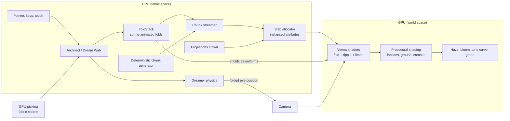

### 5.4 Picking a folded city

Ray casting against a folded city on the CPU would mean folding every vertex twice. Instead the scene is re-rendered into a 1 × 1 float render target under the cursor with pick materials that output the fabric coordinates of whatever is visible. The result is exact on curls, ceilings and walls, and costs one tiny draw per click. If float render targets are not available the picker falls back to the ground plane.

---

### 5.5 Rooms behind the windows

Walk past a lit window and you see into a room: back wall, side walls, floor and a ceiling lamp, all shifting with parallax, with no geometry behind the facade at all. This is interior mapping. The facade shader already knows which window cell a pixel belongs to, so it also knows where that pixel sits on the room's window wall. The view ray is traced from there into a box the size of the room (a flat is two windows wide and one storey tall, an office one bay of curtain wall), and whichever face it reaches first is painted: wallpaper, floorboards, a framed picture, a bookcase or a door, a pendant lamp lighting the room with a simple falloff. A cut-out card across the middle of the room carries the furniture (a sofa, a table and chairs, a floor lamp, desks with glowing monitors in offices, a counter in shops), and curtains, sheers and blinds hang in the window itself. Now and then a projection stands at a window, looking out.

Folding is no obstacle. The vertex shader carries the fabric axes through the same fold rotations as the normal, so it can hand the fragment shader the view ray expressed in fabric space, where every building is still an axis-aligned box. A room on a curled street looks right from the street below it.

Every choice (which rooms are lit, which have a television on, the wallpaper, the furniture) comes from hashing the room's id and the building's seed. Interpolation would wobble the seed's last bits and the hashes would turn that into speckle, so per-building values are passed as `flat` varyings. Once a window is only a few pixels wide the room fades back to the flat warm pane it was before. Close to, the glass the room is seen through sits back in its wall (5.11).

### 5.6 Wet streets

In the Rain the street is a mirror. Each frame the scene is rendered a second time from the camera's reflection below the street, at a fraction of the screen's resolution, with an oblique near plane (Lengyel's trick) that cuts away the street and everything under it. The ground shader projects its own world position into that image and uses it in place of the sky-only environment reflection, weighted by a generous Fresnel term:

- **Puddles** gather where a low-frequency noise dips and along the kerbs. They are darker, nearly mirror-smooth, and ripple with expanding rings where raindrops land.
- **Wet asphalt and paving** reflect through the render target's mipmaps and a vertical smear, so lamps and lit windows stretch into the long streaks of a wet night.
- **Folded streets** are not level, so they keep the plain reflection. Only street that is flat and at ground height uses the mirror.
- **Limbo's sea** reflects what is left of the city.

The mirror costs a second pass over the city's geometry, so it scales with the quality tier (6.7) and fades out above about 160 m, where the street is seen too steeply to reflect much. Without it (on Low, or from high above), the street lamps' reflections are traced analytically instead: the reflected view ray is followed up to lantern height in fabric space, and its distance from the nearest lamps on both kerbs becomes a streak, long towards the viewer and narrow across.

### 5.7 The café explosion

When stability reaches zero the city comes apart around the dreamer (or around the architect's focus), as the café street does in the film. Two halves tell the same story with the same numbers:

- **The walls.** The building shader has a blast uniform: a centre, the radius the wave front has reached, and a strength. Inside the radius each facade is cut into cells about 2.2 m wide (a Voronoi pattern on the wall's own coordinates). Once the wave passes a cell, its glass loses its sheen, cracks open along the cell borders, and a share of the cells (about 45% near the blast, none at 140 m) are blown out. A blown-out cell opens onto the room behind it, traced exactly as a window is (5.5), with a rim of broken masonry. A cell's hash decides both whether it breaks and how late the wave reaches it, so the wall breaks up raggedly rather than in a clean ring.
- **The shards.** At the moment of the blast the CPU picks up to a few thousand pieces of wall from the loaded buildings within 140 m, with the same density as the holes, mostly on the walls that face the blast and never from a wall pressed against its neighbour. Each piece gets the moment the wave reaches it, a velocity out of its wall, a tumble and a colour: the stone of its facade, dark window glass, or the red, green and blue cloth of a shopfront awning. One instanced mesh draws them all, and its vertex shader flies each one on a parabola until it lands on the street, then folds it like everything else.
- **Slow motion.** The dream's clock (everything driven by shader time, the crowd, the folds and the weather) runs at full speed for a moment and then at about a sixth of real time, while the dreamer and the cameras keep real time. The drone sinks with it and the colour drains a little. After 4.2 s the kick fires on its own; the shards shrink away and the walls heal under its flash while time comes back up to speed.

`src/world/collapse.ts` holds the timeline and the shard planner; `tests/collapse.test.ts` pins the slow motion, the automatic kick and the healing, and where the shards may come from.

### 5.8 Light and air

A box city reads as flat unless three things are right: surfaces must darken where they meet, distance must be visible as air, and bright things must roll off to white without changing colour on the way. None of the three needs an extra pass over the city.

- **Contact shadows, computed.** Ambient occlusion is normally sampled from a depth buffer. Here the painters already know where everything is, because the generator's layout is arithmetic: a perimeter block's wall stands on its building line, boulevard trees stand in a row at fixed distances into each block, lamps stand a metre inside the building line every 32 m. So the ground painter darkens the sky's light beside walls (half the sky is hidden at the foot of an 18 m wall, less further out), in courtyards, under tree crowns, round lamp posts and under the monument; the facade painter darkens walls towards the street, hardest over their last metre and a half, shades the edges of each window opening and the glass under a shop awning; and a tree's crown is darker underneath. Only the hemisphere and sky-reflection light are dimmed, never the sun, plus a little painted grime in the corner itself. It costs a few multiplies per pixel and runs on every tier. `tests/look.test.ts` pins the shaders' idea of where trees and lamps stand to the generator's.
- **Haze.** Three's fog is replaced in every folded material (`src/world/atmosphere.ts`). Things fade with distance, exponentially, towards the colour of the sky *in the direction you are looking*, warmed towards the sun, so a district hanging overhead goes blue like a far hill while a street running to the horizon pales the way the horizon does. Each level sets how thick the air is and how much extra mist lies on the ground (it thins with height, so the towers stand out of it). The sky dome and the haze share one GLSL sky function, so they cannot drift apart.
- **The edge of the city.** Over the last third of the view distance the city does not fade to a colour at all: its alpha falls to zero and what shows through is the sky that was drawn first, with its clouds, stars and moon. That hides the edge of the streamed city whichever way it is seen, including from underneath on the Paris fold and the Scroll, where a fog colour would show as a grey shape against the blue. The materials stay in the opaque pass (front to back, writing depth); only that last stretch blends.
- **Night.** The lamps light the facades beside them (a pool of light per lamp, computed from the same lattice), pale paving throws back more lamp light than asphalt, and every lantern has a halo: one instanced quad per lamp, reading the lamps' own instance buffers, drawn only at night and wider in rain and mist (`src/fx/halos.ts`).
- **Tone.** Scene light goes through the Khronos PBR Neutral curve, which keeps colours as painted until they are nearly white, then a small display grade per level (exposure, split-tone tint, saturation, and contrast as an S-curve that leaves black and white where they are). AgX (softer, film-like) and the old ACES curve are a link parameter away for comparison.

Every dial is in `src/world/look.ts` (global) and `src/world/themes.ts` (per level), and the global ones can be set from the link: `#tone=neutral|agx|aces`, and `#ao=`, `#haze=`, `#glow=`, `#exposure=`, `#contrast=`, `#saturation=` as multipliers. `#tone=aces&ao=0&haze=0&glow=0` is close to the look before this pass.

A look cannot be reviewed from a diff, so `npm run bench` (after `npm run build`) renders the same eight seeded views at each quality tier and prints draw calls, triangles and render-target memory for each; `--compare` lays two runs side by side. It needs Playwright, which is not a dependency of the game.

Before and after, from the bench (Medium, the same seed and view):

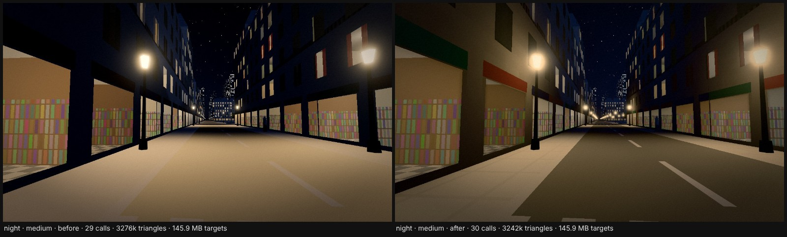

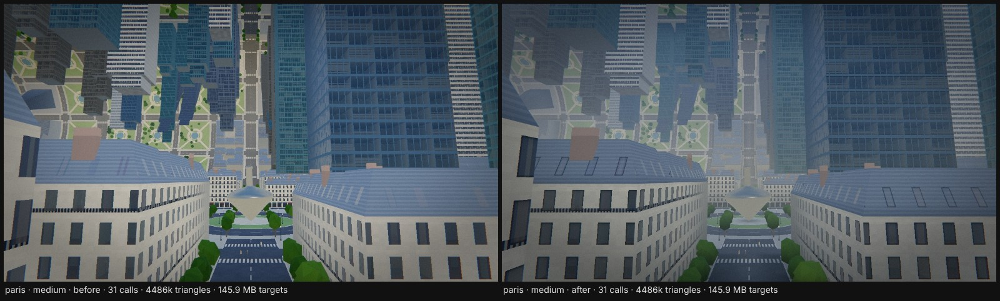

### 5.9 People

The dreamer and every projection are the same kind of thing: a body built in code, on one shared skeleton, moved by the same few clips.

- **The skeleton and the clips are the one thing not generated here.** They come from Quaternius's Universal Animation Library, which is CC0 (see `ASSETS.md`). `scripts/pack-people.mjs` keeps 22 of its bones and eleven clips (standing, talking, two walks, a jog, a sprint, a jump, a landing, a blow, a reach and a jab), quantises them to 16 bits and writes them into `src/people/rigdata.ts`, about 60 kB. The pack's own mesh is not used and nothing is downloaded at run time. `src/people/rig.ts` decodes the clips, samples and blends poses, and has no dependency on the 3D engine.
- **Bodies are lofts.** `src/people/body.ts` strings rings of vertices along the skeleton's limbs, torso and head, each ring tied to one or two bones: a jacket with a hem that follows the thighs, sleeves that hang from a ball at the shoulder, trouser legs, shoes with heels, a collar, a tie. A hat, long hair, a skirt, the skirts of a long coat and a bag are extra pieces in the same mesh. The same builder makes the dreamer (about 5,700 triangles) and a pedestrian (about 900 of the crowd mesh's 1,150, depending on what they wear), and builds a man and a woman from the same vertices in the same order, so one can be morphed into the other.
- **The dreamer** is an ordinary skinned mesh with its own bones (`src/people/figure.ts`), posed on the CPU. That costs one draw call (and one in the shadow pass) where the capsule figure it replaced cost twenty.
- **The crowd is one instanced mesh, drawn in one call** (`src/people/crowd.ts`). Every clip's bones are baked into a small half-float texture: a row for each frame, three texels for each bone. Each pedestrian is two dozen numbers: where they are, which row of the texture they are on (and, while changing clips, the row they are leaving and how much of it is left), how far their head is turned, their build, the pieces they wear, and their colours. The vertex shader shrinks the pieces a person does not wear to a point, morphs the build, turns the head on the neck, reads two bones from the texture (the sampler blends between frames) and skins the vertex, then hands it to the same fold maths as a lamp post. Colour comes from what the vertex is made of: jacket, trousers, shirt, tie, skin, hair, shoes.
- **Feet do not slide.** `pack-people.mjs` measures, for each walking clip, how far a planted foot travels under the hips in one cycle: its stride. Wherever a clip is played, its phase moves on by distance covered divided by that stride. Pedestrians walk at their own pace around the pace their walk was animated at (about 0.9 to 1.4 m/s), so a hurried walker simply takes quicker steps. All walking clips start as the left foot lands, so a walk can turn into a run, or a stroll be mixed with a jog, frame for frame.
- **What they do.** They walk the sidewalk lattice as before (`src/world/projections.ts`); a few stand at corners for a while, talking or waiting. As suspicion rises they turn their heads to follow the dreamer, then stop and face them, then run at them. Changes of clip fade over a third of a second.
- **Cost.** Sorted nearest first each frame, so the shadow pass stops after the people within 110 m: a far-off pedestrian's shadow is a pixel or two. On Medium (400 people) an ordinary street costs the same 29 draw calls as before and about 8% more triangles; behind the dreamer the frame went from 69 draw calls to 31.

`tests/people.test.ts` pins the skeleton and the clips (unit rotations, loops that close), the gait mix, planted feet against each clip's stride, the body builder's weights and budgets, the bone texture against the CPU poses, the wardrobe, and the crowd's walking, staring and hunting. `/lab.html` (dev server only) shows the figure and the crowd out of the city.

Before and after, from the bench (Medium, the same seed and view):

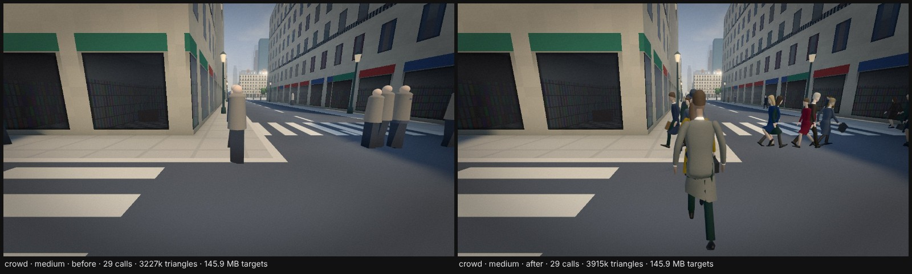

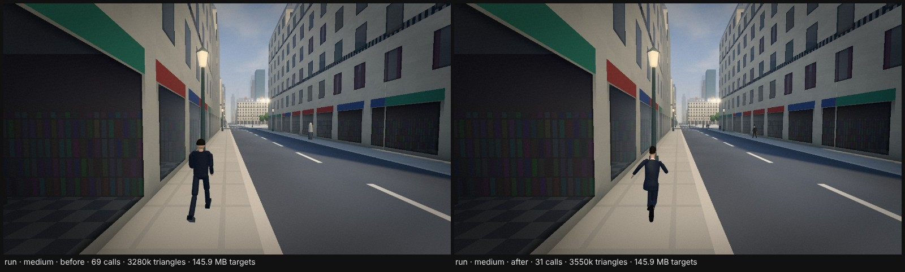

### 5.10 Sound

Two kinds of sound are layered. The drone (tuned to each level), the rumble of a folding city, the BRAAAM, the kick, the wind and the heist's music box are made from oscillators and noise, as before. Over them are recordings: a bed of air for each level, the crowd's murmur, and footsteps.

- **The recordings are CC0 and small.** `scripts/pack-sounds.mjs` downloads thirteen public-domain recordings (the list, with authors, is in `ASSETS.md`), cuts and filters them, brings them to one loudness and writes eight mono Ogg Opus files into `src/fx/sounds/`: about 830 kB against a budget of 1.5 MB, which a test enforces. The single-file build carries them as data inside the page. Each is fetched and decoded the first time it is needed, so the Rain's rain costs nothing until it rains, and a browser that cannot decode Opus keeps the generated sound and a generated footstep.
- **Loops are closed after decoding.** A lossy codec does not promise that a file's last sample runs on into its first. So every looping file holds its loop and then a few seconds more, and the game fades that tail back in over the loop's start (equal power). The seam is then the recording running on as it really did.
- **What is heard where is plain arithmetic** (`src/fx/soundscape.ts`, no Web Audio in it, so it is tested). A scene is a dozen numbers: the level's rain, snow and Limbo, the hour, whether the ears are on the street or up at the Architect's camera and how high, whether they are in the hallway, how far under an awning, how much green is near, how close the sea. `mixBeds` turns it into a loudness and a low-pass for each of seven beds.

| Where | What is under the drone |
| --- | --- |
| Level 1, the City | a far rumble of traffic beyond the rooftops; birds by day, more of them near parks, the Circus lawn and the boulevards' trees |
| Level 2, the Rain | rain; against a facade it moves onto the awnings overhead and gets lower and closer |
| Level 3, the Snow | wind, and the city almost gone |
| Limbo | the sea, louder towards the shore |
| The hallway | a hum; everything outside is muffled to a third |
| The Architect's height | the street falls away with altitude and the wind takes over |

- **Footsteps follow the surface.** The ground is painted by a shader, so nothing in the scene says "this is grass". `src/city/surface.ts` reads the same layout rules on the CPU: roadway or sidewalk, the Circus's rings, a park's lawn, gravel paths, pond and its stone rim. `footing` then picks from eight sets of recorded steps for the dream as well as the ground: stone (duller on tarmac), gravel, grass, the same with a splash under it in the Rain, snow over everything in the Snow (with stone showing through on the ploughed roads), water in the pond and where Limbo's sea has come in, carpet on the hallway's floor and wood on its walls and ceiling. Each step picks a take it did not just use and varies a little in pitch and loudness. There is no metal underfoot anywhere in the city, so there are no metal steps.
- **The crowd is heard where it stands.** The people nearest the listener are boiled down to three murmuring groups, one for each third of the compass, each standing at the centre of its people and as loud as they are many and near. The murmur itself is one short recording of a few voices layered fourteen times, slowed, until no word survives. It hushes when the projections stop to stare and rises and brightens when they give chase. The footsteps of the nearest walkers are played from where their feet land, on the beat of their own animation (5.9).
- **Placed around the head.** The murmuring groups, other people's footsteps, the heist's music box and the sleep machine's hum each go through an HRTF panner, with headphones in mind: the music box can be found by turning your head. The panners carry direction only; loudness over distance is worked out by the caller, which knows about folds and walls. On Low quality they fall back to plain left-right panning, which costs almost nothing.
- **Slow motion** lowers the beds' pitch and takes their top off along with the drone's, and a fade between dreams fades them with the picture.

`tests/sound.test.ts` pins the surface reader against the layout, each level's bed, the footstep for each surface and dream, the crowd's voices, the direction maths, the loop seam, the size of the recordings and their credits. `npm run listen` (`scripts/listen.mjs`) is the listening bench: a headless copy of the game played through nine scenes and recorded, with a table of levels. The recordings were chosen and balanced with it, from descriptions, spectrograms and measurements; a pair of ears is still the better judge, and every level is one number at the top of `src/fx/audio.ts`.

### 5.11 Walls with depth

The buildings are boxes, and for a long time their windows were paint: fine from the air, stickers from the pavement. Real walls have thickness. The glass sits back in its opening, stone stands out in bands and ledges, and the sun picks all of it out. None of that needs geometry, because the facade painter already knows three things at every pixel: where the pixel is on the wall, where the eye is, and where the sun is.

- **Window reveals.** The room trace of 5.5 used to start on the wall's face. Now the line of sight is followed in from the face for the depth of the reveal (25 cm on a Haussmann front, less on brick, concrete and the shopfronts, 7 cm behind a curtain wall's mullions). Either it meets a side of the opening first, and the pixel is the reveal's stone: a jamb facing across the opening, a sill facing up, a lintel facing down. Or it reaches the glass, further along than where it went in, and the room trace starts from there, which is what makes the window shift against its opening as you walk past. On the glass stand the frame and its glazing bars.
- **The sun on the reveal.** A reveal's face is lit like any other surface, by its own normal: the jamb that faces the sun is bright, the lintel is dark. Whether the opposite edge of the opening shades a point is one more similar-triangles step, towards the sun this time: from the point back out to the wall's face, and a test of whether that lands inside the opening. The same step throws the wall's shadow across the glass, its frame and the curtains behind it, which by day and close to are lit as cloth in the daylight instead of as a dark glow.
- **Ledges and their shadows.** The cornice, the string course under each floor, the balconies' slabs, the shop awnings and brick window sills stand out from the wall by a known reach, so the wall under each is in shadow for that reach times the sun's height over the wall. That is one multiply and one smoothstep per ledge. These shadows last as long as the pattern itself does (6.4), so a sunlit Haussmann front carries the lines under its balconies from across the square.
- **Joints and mouldings.** The same patterns that paint stone courses, brick bonding, cast panels and slates also say how the surface leans: across a joint, round a string course, under a cornice, along the bevel of a window surround. The lean turns the normal the light falls on. A joint narrower than a few pixels is not carved at all, because a bump that fine only sparkles.
- **How it reaches the light.** The painter works in the wall's own axes (along it, up it, out of it), found from screen derivatives of the position and of the wall's own coordinates, so it holds on a curled street too. The turned normal is handed to the standard lighting; the sun's direct light is then multiplied by the relief's shadows after the lights are summed, which is safe because the sun (the moon, at night) is the only light with a direction. At night a lit room spills a little of its light onto its own reveal.
- **What it costs.** No draw calls, no triangles, no textures and no render targets: the bench's numbers do not move. Per pixel it is a handful of multiplies, and the pixels that land on a reveal skip the room trace altogether. Reveals, frames and the cloth fade out between about 27 and 38 m on Medium (34 to 48 m on High), by shrinking the reveal's depth to nothing, so nothing pops. Low leaves the relief out of the building shader altogether (it is compiled in only when a `RELIEF` define is set), so Low draws and costs what it did before; `#relief=0` does the same on any tier, which makes it the fair comparison when timing. A café-explosion hole is cut through the wall's face, so it ignores the reveal and opens straight onto its room.

`#relief=` scales the lot from the link (0 is flat walls, 1 the default, 2 for deep-set windows).

Timed on an integrated GPU (AMD Radeon Vega 8, 1280 × 720, the middle of three page loads per view), the relief costs Medium about 2 to 3 ms a frame on views of nearby facades, about 5 percent, and nothing on Low, which compiles it out. Frame times on that machine drift by more than that between runs, so time before and after alternately (`npm run bench -- --gpu --time --repeat 3`).

Before and after, from the bench (Medium, the same seed and view):

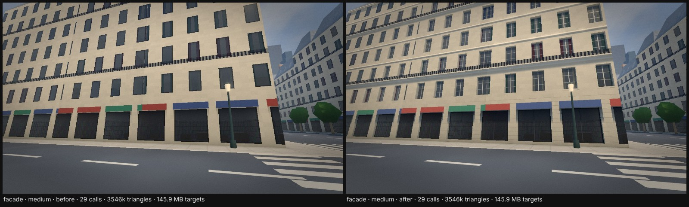

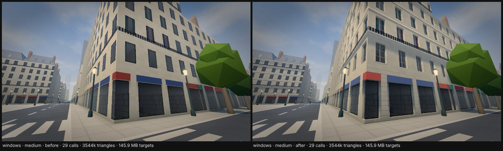

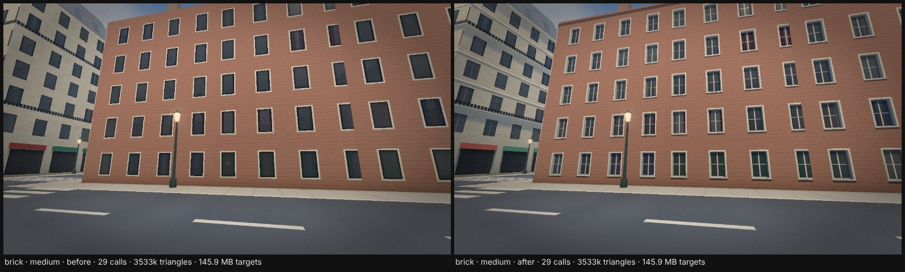

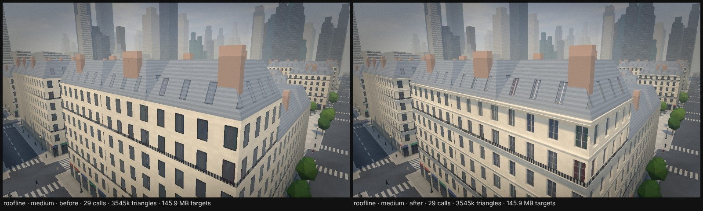

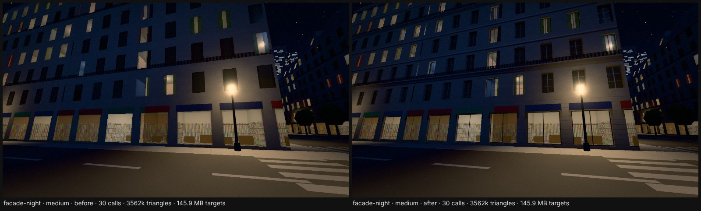

### 5.12 The hallway, built in Blender

The rotating hallway (4.3) was a painted box: four flat walls whose carpet, panelling, doors and lamps were all painted by its shader. It is mostly seen up close and turned on its side, which is where paint gives itself away. On Medium and High it is now a modelled hotel corridor with its light baked in, and the painted box stays as the fallback.

- **Made from numbers.** `art/hallway/build_hallway.py` builds the corridor in Blender: a skirting, a chair rail and raised wood panels below it, picture-frame mouldings and a picture rail above, a coved cornice, panelled doors set 12 cm back into their walls with architraves, kick plates, knobs and number plates, sconces with half-drum shades, a coffered ceiling with a glass light in each coffer, and the chamfered stone outside with its section rings and the bands round the open ends. Nothing is downloaded. It runs in Blender 5.3, or in a plain Python with the `bpy` module, so it needs no Blender installed and no screen. `scripts/pack-hallway.mjs` runs it and compresses the result.
- **The light is baked.** Cycles bakes the light of the fourteen sconces (their shades glow, and each throws a scallop up the wall and a pool down it) and the seven ceiling lights, with five diffuse bounces, into one 1024 × 1024 lightmap on the model's only UV set. The corridor is symmetric across its middle both ways, so only a quarter of it is in the file, and it is baked with its three mirror images standing beside it so that every lamp in the corridor lights it. The game mirrors the quarter back into the whole corridor. A quarter's lightmap at 1024 is as sharp as the whole corridor's would be at 2048.
- **Light, not paint, in the lightmap.** Each vertex carries its base colour and its kind of surface (carpet, wallpaper, wood, door, trim, plaster, brass, shade, glass, and three kinds of stone outside). The game's shader multiplies the bake by the surface's own pattern at full resolution: the carpet's lattice and border, the wallpaper's satin stripes and damask, walnut and mahogany grain, and the room numbers on the brass plates. The lightmap is light only, so it is smooth and compresses to almost nothing.
- **Inside baked, outside sunlit.** The inside and the stone outside are two groups of one mesh, drawn with two materials. The inside has no lights at all (a `MeshBasicMaterial`): its light is the bake, which turns with the corridor because it is part of it, plus a little of the sky's light at the open ends, gone a few metres in. The stone outside is lit by the sun and the sky like the rest of the city. The first version drew both with one lit material and skipped the light loop inside with a branch; on Direct3D that branch, and the painter's derivatives inside its own branches, can be flattened so every pixel pays for everything, and it cost Medium about 12 ms a frame on an integrated GPU. The painter now takes the corridor's screen derivatives once, before it branches on the kind of surface.
- **What did not change.** The rider's physics is the same analytic box: its walked-on planes are at ±3.5 m exactly, and nothing in the model stands into that box by more than 8 cm (doors, coffers and lamps are set back into the walls instead), so nothing catches the feet or the third-person camera. The corridor stays rigid at the fold of its centre, its footsteps are the same carpet and panelling, and on Low, or with `#hall=0`, the painted box is drawn exactly as before.
- **What it costs.** The file is about 110 kB (meshopt geometry, WebP lightmap), loaded just after the first frame with three's GLTFLoader and meshopt decoder, which add about 30 kB gzipped to the game. The painted box draws until it arrives and if it cannot be read. It is two draw calls where the painted box was one (and two in the sun's shadow pass), about 13,000 triangles for the whole corridor. TIMING_HERE

Before and after, from the bench (Medium, the same seed and view):

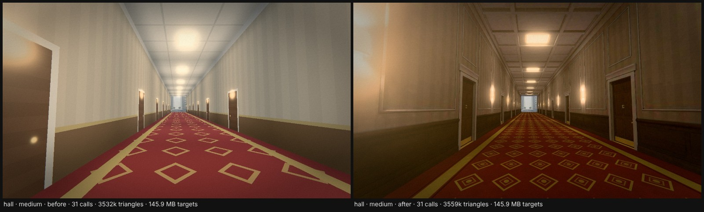

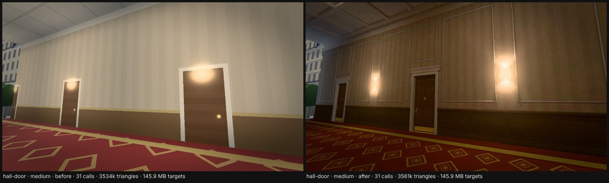

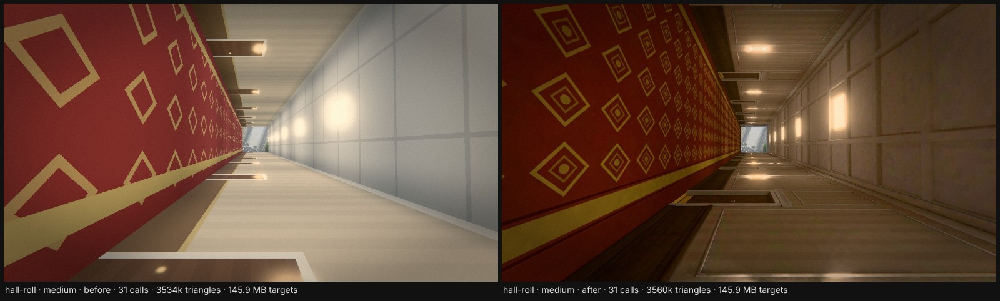

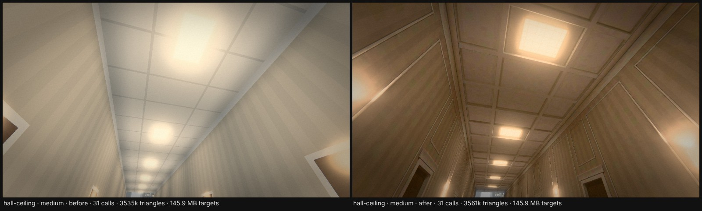

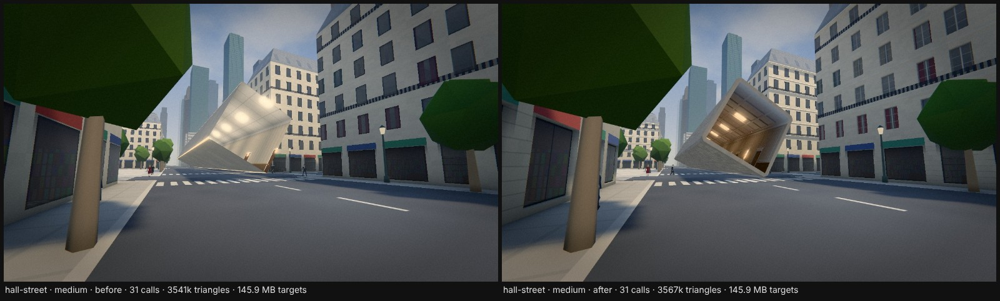

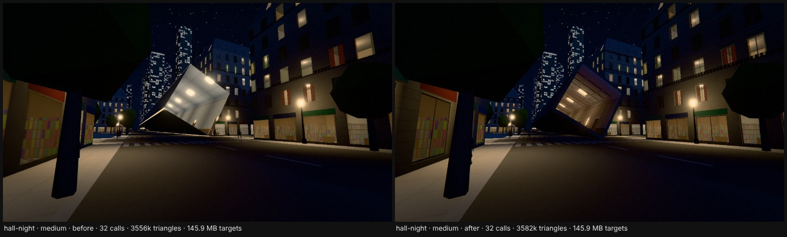

## 6. Scaling

The goal is a city that is effectively infinite, foldable in real time, and still smooth on a phone. Each of the decisions below exists to keep one cost constant as the city grows.

### 6.1 Deterministic generation

Every chunk is a pure function of (chunk x, chunk z, seed). Nothing is stored. A chunk can be thrown away and regenerated identically, which means memory is bounded by what is visible rather than by what has been visited. The only persistent per-block state is the architect's raise-brush edits, held in a small sparse map.

### 6.2 Streaming after folding

Candidate chunks are enumerated in fabric space around the camera's fabric focus. The decision to load is made on each chunk's **world** distance after folding. This matters: under the Paris fold, chunks that are 800 m away on the sheet are hanging 200 m above your head, so they must be loaded even though a flat distance check would drop them. Chunks are loaded nearest-first under a per-frame budget so a big fold never causes a hitch, and new chunks rise out of the ground rather than popping in.

### 6.3 Constant draw calls

Each kind of object (buildings, roofs and chimneys, fine ground, coarse ground, trees, lamps, the crowd, the monument) is a single instanced mesh. Each loaded chunk owns one fixed-size slab of instances in each mesh (224 buildings, 288 roof pieces, 128 trees, 128 lamps). Loading a chunk writes its slab and uploads just that range. Unloading zeroes it. Empty slots collapse to a point in the vertex shader before any fold maths runs.

The result is about eleven draw calls for the whole city, whether it has two thousand buildings or twenty thousand. (At night the lamp halos add one more, and another in the Rain, where the wet street mirrors them.)

### 6.4 Level of detail

- **Ground tiles** come in two tessellations. Only chunks crossed by a curl get the fine 40 × 40 grid needed to bend smoothly. Everywhere else a 2 × 2 tile is enough.
- **Props** (trees and lamps) are only written for chunks inside a smaller ring around the viewer, with their own budget per frame.
- **Facades** fade their window pattern to its average colour once a window is only a few pixels wide, which removes moiré without textures or mipmaps. The rooms behind the windows are only traced while a window is big enough on screen to show one, and the window reveals, frames and carved joints (5.11) only within a few dozen metres.
- **The crowd** is a single instanced mesh of skinned people (5.9). Its size follows the quality tier, from 180 to 900 people, and only those within 110 m are drawn into the shadow map.
- **The café explosion** throws between 1,600 (Low) and 7,000 (Ultra) shards, all in one instanced mesh that is hidden the rest of the time. The building shader's blast branch costs one uniform test per pixel while the dream holds.

### 6.5 No textures

All surface detail comes from procedural shading: limestone courses, shopfronts and awnings, balconies, cornices, brick bonding, curtain-wall mullions, mansard zinc, the rooms behind the windows, snow cover, puddles and raindrop ripples, crosswalks, park paths, lamp pools, contact shadows (5.8), window reveals and the shadows under ledges (5.11), glowing crease lines and the glowing lattice on the underside of a fold. The build ships no image assets at all. The whole app, including the 3D engine and the people's packed animation (5.9), is about 940 kB of JavaScript (about 290 kB gzipped), beside about 830 kB of recorded sound (5.10) that is fetched as it is needed.

### 6.6 Bounded fold cost

Fold state is two arrays of eight vec4 uniforms. Every vertex pays for at most eight folds, and the loop exits early for points before a hinge. Shadows use depth materials with the same fold, so shadows bend with the city at no extra CPU cost.

### 6.7 Adaptive quality

Four tiers (low, medium, high, ultra) set pixel ratio, shadow map size and extent, bloom, the wet-street mirror's resolution, how far the window reveals reach, view distance, prop distance, chunk cap and crowd size. The app starts from a guess based on the device and then watches the frame rate, stepping down a tier when it drops below about 38 fps and back up (as far as High) when it holds above 57 fps. Ultra is opt-in from the panel, and `#q=` in the URL pins any tier.

| Tier | Pixel ratio | Shadows | Bloom | Wet-street mirror | Window reveals | View distance | Chunk cap | Crowd |
| --- | --- | --- | --- | --- | --- | --- | --- | --- |
| Ultra | 2 | 4096 | yes | ½ resolution | to 64 m | 1300 m | 150 | 900 |
| High | 1.5 | 2048 | yes | ½ resolution | to 48 m | 1050 m | 120 | 600 |
| Medium | 1 | 2048 | yes | ⅓ resolution | to 38 m | 820 m | 90 | 400 |
| Low | 0.75 | off | no | lamp reflections only | flat walls | 620 m | 60 | 180 |

### 6.8 State that fits in a link

A whole dream is a seed, a level, a time of day and at most eight folds of six numbers each. That fits in a URL hash with room to spare, so every view is shareable and reproducible. It is also the foundation for multiplayer (below): because the world is deterministic, peers only ever need to exchange the fold log, never geometry.

---

## 7. Where it goes next

### Milestone 1: the playable dream (done)
- Endless procedural Paris with five districts and the Circus monument
- Architect mode with folds, raise brush, five dreamscapes and shareable links
- Dream Walk with fabric-space physics, walking up curls and the kick
- Four dream levels with weather, day and night, and time dilation
- The projections crowd and the stability system
- Procedural audio, bloom and grade, adaptive quality, touch controls

### Milestone 1.1: the hallway and the ride (done)
- The rotating hallway, with its own physics and a dreamscape
- Riding the fold: the street you stand on carries you over the city
- Solid plates behind all HUD text so it reads over any sky or street

### Milestone 1.2: close-up realism (done)
- Rooms behind the windows, traced in the facade shader, with lamps, curtains and furniture
- Wet streets in the Rain: the city mirrored in puddles and smeared across wet asphalt, rippled by raindrops

### Milestone 1.3: the café explosion (done)
- When stability hits zero the facades crack and blow out in slow motion, then the kick arrives on its own

### Milestone 1.4: Heist mode (done)
- A game in the folded city: sleep machines down, found kicks up, a target to plant an idea in, a totem, and a topside clock that slows with depth (4.5)

### Milestone 1.5: behind the dreamer (done)
- A third-person camera in Dream Walk that shows the dreamer's own body, walking, running and jumping, and keeps out of buildings, curls and the hallway's walls (4.6)

### Milestone 1.6: light and air (done)
- Computed contact shadows, haze that takes the sky's colour and hides the city's edge, lamp light and halos at night, a neutral tone curve with every dial in one place, and a screenshot bench for judging changes like these (5.8)

### Milestone 1.7: people (done)
- The dreamer as a skinned man in a suit who really walks, runs and jumps, and a crowd of varied pedestrians (suits, long coats, dresses, hats, briefcases) who walk, stand, turn to stare and run, all in one draw call, on free CC0 animation (5.9)

### Milestone 1.8: sound (done)
- Recorded air for each level and the hallway, footsteps that follow the surface and the weather, a crowd that murmurs from where it stands, and the heist's kick and sleep machine placed around the head, all from CC0 recordings under a megabyte, with a listening bench for judging changes like these (5.10)

### Milestone 1.9: walls with depth (done)
- Windows set back in their walls with lit and shaded reveals, frames and glazing bars; cornices, string courses, balconies, awnings and sills that shade the wall under them; carved joints in stone, brick and concrete. All in the facade painter, with no new geometry (5.11)

### Milestone 1.10: the hallway, built in Blender (this release)
- The rotating hallway as a modelled hotel corridor (wainscot, mouldings, panelled doors with their numbers, sconces, a coffered ceiling, carpet and wallpaper) with its lamps' light baked in Cycles, in a 110 kB file, built from a script with nothing downloaded (5.12)

### Milestone 2: a shared dream
- Multiplayer through an ordered fold log over WebRTC or a small relay. Each fold is a six-number event with a timestamp, so late joiners replay the log and arrive in the same city.
- See other dreamers as projections that do not turn on you.
- The architect and the dreamer as two different people: one folds the city while the other walks it.

### Milestone 3: deeper physics
- Mirror bridges: a fold of exactly 180° with zero radius that copies the street onto itself as a reflective arch.
- Projection crowds that react to each other as well as to you.

### Milestone 4: new targets
- WebGPU renderer with compute-driven culling, which moves the remaining per-frame CPU work (crowd, culling) onto the GPU and raises the building budget by an order of magnitude.
- WebXR: walk the folded city in VR, where the curl rising ahead is at its most unsettling.
- Recordable flights: export a fold sequence and camera path as a short film.

---

## 8. Code map

| Path | What lives there |
| --- | --- |
| `src/core/fold.ts` | Fold algebra (CPU), fold ordering, the spring-animated FoldStack |
| `src/core/config.ts` | Grid constants, slab sizes, street widths |
| `src/core/rng.ts` | Seeded hashing, value noise and fBm |
| `src/city/generator.ts` | Deterministic chunk generation: blocks, lots, towers, roofs, props |
| `src/city/shaders.ts` | GLSL: fold transform, facade painter (rooms, window reveals, relief), ground painter, props, people, picking |
| `src/city/materials.ts` | Shared uniforms and patched Three.js materials, depth and pick variants |
| `src/city/pool.ts` | The slab allocator for instanced attributes |
| `src/city/streamer.ts` | World-space streaming, LOD, collision and raise-brush edits |
| `src/world/` | Sky, sun and weather, dream levels, the projections crowd |
| `src/world/atmosphere.ts` | The sky's colour function and the haze that replaces fog in every folded material |
| `src/world/look.ts` | The dials for the look (tone curve, ambient occlusion, haze, glow, wall relief, the modelled hallway) and their link parameters |
| `src/world/hallway.ts` | The rotating hallway: the painted box, the rider's physics, and which corridor is drawn |
| `src/world/hallwayModel.ts`, `src/world/hallway/` | The corridor modelled and baked in Blender: loading, mirroring the quarter, and its painter |
| `art/hallway/build_hallway.py`, `scripts/pack-hallway.mjs` | Builds, lights and bakes the corridor in Blender, then compresses it into `src/world/hallway/` |
| `src/world/collapse.ts` | The café explosion: the shard planner, the slow-motion timeline and the automatic kick |
| `src/world/dreamer.ts` | The dreamer's body for the third-person view: which clips to mix, the stride clock, the head turn |
| `src/world/projections.ts` | The crowd's behaviour: walking the sidewalks, standing, staring, hunting, and which clip each one is in |
| `src/people/rig.ts`, `rigdata.ts` | The shared skeleton and its clips (packed CC0 animation, see `ASSETS.md`): sampling, blending, gait and stride |
| `src/people/body.ts` | Bodies and clothes built in code as lofts on the skeleton, for the dreamer and for the crowd |
| `src/people/figure.ts` | One skinned figure with its own bones (the dreamer) |
| `src/people/crowd.ts` | The crowd's mesh, the bone texture, the wardrobe and the instanced `People` |
| `scripts/pack-people.mjs` | Packs the skeleton and clips from the animation library into `rigdata.ts` and measures each walk's stride |
| `lab.html`, `src/lab.ts` | A dev-only page for looking at the figure, the clips and the crowd out of the city |
| `src/modes/` | Architect controls, Dream Walk controls, presets, the ride fold (`ride.ts`), the third-person camera boom (`chase.ts`) |
| `src/game/heist.ts` | Heist mode's rules: the topside clock, health, Limbo, placement and the kicks |
| `src/game/marks.ts` | Heist mode's things in the city: sleep machine, gramophone, totem, target and their beams |
| `src/fx/` | GPU picking, post-processing, the wet-street mirror (`reflection.ts`), lamp halos (`halos.ts`) |
| `src/fx/audio.ts` | Sound: the generated drone, rumble, BRAAAM and beacons, and the player for the recorded beds, footsteps and crowd |
| `src/fx/soundscape.ts` | What should be heard where: the bed mix for a scene, the footstep for a surface, the crowd's voices, the loop seam |
| `src/fx/soundbank.ts`, `src/fx/sounds/` | The packed CC0 recordings (see `ASSETS.md`) and their lazy loader |
| `src/city/surface.ts` | What is underfoot at a point of the fabric, read on the CPU from the ground painter's rules |
| `scripts/pack-sounds.mjs` | Downloads, cuts, levels and encodes the recordings into `src/fx/sounds/` |
| `scripts/listen.mjs` | The listening bench: the game's sound recorded scene by scene, with levels |
| `scripts/bench.mjs` | The screenshot bench: eight seeded views per quality tier, with draw calls, triangles and memory |
| `src/ui/` | Styles and the HUD totem |
| `tests/` | Fold algebra, generator, hallway, ride, wet-street mirror, café explosion, Heist mode, third-person camera, lighting-layout, people and sound tests |
